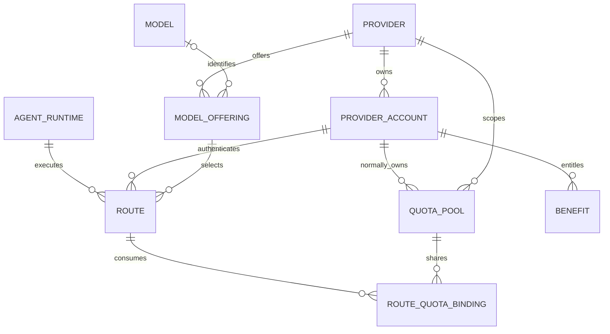

# Agent / Provider / Model：存储与交互设计提案

状态：设计提案；生产 adapter、数据库和现有 console 尚未迁移。
更新：用户确认首屏应以配置模板、Agent 权限和 Project 绑定为主。交互与配置存储以 [template-console-design.md](template-console-design.md) 为准；本文件的账号、共享资源和 Cache 边界可继续复用。
作者：GPT parent。独立验收作者：通过 mixed-agents 选择其他模型系列。

## 行为与验收条件（先于原型）

1. 同一模型经两个 Provider 提供时，显示两个模型入口；额度和 Cache 不因模型同名而合并。
2. 一个 Provider 账号供两个 Agent 使用时，账号只配置一次；明确共享的额度池只展示、扣减一次。多个密钥不自动等于多个账号。
3. 同账号模型可以共享五小时/每周额度；不同模型入口仍可有独立限流。一次调用须同时满足所有绑定的额度窗口和并发范围。
4. 权益须匹配 Agent、账号套餐、模型入口、执行方式和有效期；Kimi 自家组合与 Zcode 闲时队列以用户提供的需求案例建模，数值和商业规则需供应商证据后启用。
5. 不产生 Agent × Provider × Model 的笛卡尔积。支持性分为已验证、仅配置、未知、不支持；只有经过 adapter、认证、能力和额度检查的组合才能执行。
6. 页面默认展示立即可用组合；额度未知、读数过期、并发已满、凭据失效、尚未接入均有不同原因和对应动作。加载页面不运行推理。
7. 优惠不能覆盖任务能力、模型系列独立性、认证、并发或额度保护条件。精确指定的组合不能静默替换。
8. 等待明确区分本地等待与供应商队列；只在任务授权等待且有截止时间时排队，取消、恢复与超时可解释。即刻执行需要付费时再次选择执行方式，不能自动升级。
9. 已运行任务固定实际组合与配置快照；更改账号或策略只影响后续尝试。写任务失败不自动换模型重跑。
10. 原型可切换组合、查看账号共用额度、查看 Agent 接入状态、查看同模型的不同 Provider 入口，并预览未来队列；所有读数标为示例。未来 adapter 不呈现为当前可执行。
11. 原型支持键盘操作和 320px–1024px 宽度；详情切换后行动和阻塞原因同步，无隐含后台请求，无凭据。

## 核心判断

用户提出的三个对象都成立，但 Provider 必须有账号层，Model 必须有入口层。用户操作的主对象是「运行组合」。Cache、额度和并发分别有自己的范围，不能挂在抽象 Model 上。

Agent 工具（Kimi Code）≠ 模型系列（Kimi / GLM / GPT）≠ 一次 worker。目前 GLM 可通过 Kimi CLI 运行；现有 native GPT 是宿主托管入口，不能伪装成 Kimi CLI。Zcode、Claude Code 是未来 adapter。

## 建议的关系

模型入口映射到抽象模型可以为空：供应商的滚动别名可能无法确认真实版本。不可按显示名称猜型号。账号和入口必须属于同一 Provider；兼容性由 adapter 验证。

## 本地存储

沿用本地 SQLite，向现有状态库新增配置实体。现有 `agents` 表保留为运行记录；新实体使用 `agent_runtimes`，避免混用。相关配置、额度绑定和版本号在同一事务提交。配置快照可导出脱敏 JSON，JSON 不再与数据库构成双主写源。

| 表 | 最小字段 | 约束 / 意图 |
| --- | --- | --- |
| `agent_runtimes` | id, agent_type, host_id, instance_key, adapter_version, enabled, discovery_state | unique(host_id, agent_type, instance_key)；记录安装/宿主入口，能力由 adapter 返回 |
| `providers` | id, name | 供应商身份；endpoint 放在具体入口，支持区域/协议差异 |
| `provider_accounts` | id, provider_id, label, external_subject_ref, credential_ref, credential_state, credential_verified_at, plan_key, plan_verified_at, enabled, revision | credential_ref 指向现有 CLI/OAuth/Keychain；不复制密钥；不同密钥与账号身份分开 |
| `models` | id, developer, name, version, family | unique(developer, name, version)，未知版本不建猜测的 canonical model；家族独立性存于这里，不可由 Agent 或 Provider 推导 |
| `model_offerings` | id, provider_id, model_id?, upstream_model_id, endpoint_ref, protocol, capability_snapshot, verified_at, revision | unique(provider_id, endpoint_ref, upstream_model_id)；能力与价格以入口证据为准 |
| `routes` | id, agent_runtime_id, account_id, offering_id, execution_mode, adapter_binding_ref, support_state, verified_at, enabled, revision | unique(runtime, account, offering, mode)；保存精确 CLI alias 引用，UI 使用友好名称 |
| `quota_pools` | id, provider_id, account_id?, external_pool_ref?, scope_key, pool_key, metric, window_kind, window_seconds?, guard_enabled?, guard_threshold?, freshness_seconds, reader_capability | unique(provider_id, scope_key, pool_key)；发现走 upsert；scope_key 为 account:id 或 organization:已验证引用；五小时和每周为不同 pool_key |
| `route_quota_bindings` | route_id, quota_pool_id | 复合主键；一个组合可同时消耗多个池 |
| `benefits` | id, account_id, plan_key?, account_revision?, agent_type?, offering_id?, execution_mode?, kind, value_json, valid_from?, valid_until?, source_ref, verification_state, verified_at | 限定维度为 AND；空表示全部；换套餐/账号后重新核实；只提供有限枚举权益，无任意脚本规则引擎 |

`execution_mode` 先支持 `immediate`。未来 adapter 验证后再加入 `provider_queue`；本地等待是任务调度状态，不必复制一条模型入口。托管账号可以没有 credential_ref，由宿主提供身份和容量，不能编造余额。

额度池必须有账号或可信的外部池身份（CHECK 拒绝双空）。模型同名或窗口同长都不构成池身份；供应商明确独立的两种五小时额度仍可有不同 pool_key。同一 Provider 的多 endpoint 同 upstream 模型也保留不同入口。

新增 `account_probe_state(account_id, last_claim_at, cooldown_minutes)`，保留现有 claims 的账号冷却原子性。`account_aliases(account_id, runtime_id, exact_alias, legacy_identity_ref)` 是旧 prefix/本地 credential fingerprint 与新账号 ID 的过渡映射；私有 fingerprint 不进入 UI。已识别相同账号合并时继承最严格上限和最晚探测时间。换 key 不重置账号 ID 或冷却；没有主体证据的新凭据标「身份未验证」，不自动合并、不自动获得一次额外探测授权。现有 credential 指纹只能识别部分同账号关系，无法识别的真实共享关系必须列为限制，不能声称密钥级去重等于真实账号级去重。

组合权益 V1 恒挂一个真实或宿主托管账号，供应商通用规则可在发现时展开为账号权益；暂不新增通用组织权益模板。托管身份不可用于绕过 CLI 账号容量。Agent 发现状态同时记录禁用嵌套 delegation 的检查结果；未通过不能接入桥接 worker。

以 CHECK/FK/应用校验限制 enum、百分比、正整数和 Provider 归属；`enabled` 与 `support_state` 分开。运行记录引用配置时使用停用而非级联删除，防止历史失真。

### Cache：隔离默认值与证据

模型入口上声明 Cache 范围模板，运行组合解析到具体账号后生成保守的 Cache namespace：Provider + 实际账号/项目 + endpoint/region + upstream_model_id + 请求相关配置 revision。改显示名称不改变 Cache 范围。跨 Provider 永不合并；换账号默认不复用。跨 Agent 不必强制不同 namespace，但只有供应商确认范围、请求前缀实际相容时才可报告可能复用；会话消息、工具 schema 和系统 prompt 变化会影响命中。

入口明确加 `cache_scope_template`、`cache_scope_verified_at`，组合明确加 `resolved_cache_scope_ref`。范围无法确认时显示「未知」，不能声称暖 Cache。这里只存边界与命中观测，不把云端 KV Cache 保存到 SQLite，也不把本地响应缓存当推理 Cache。

### 额度、并发与事实来源

保留现有 exact-alias 级历史调用 observations，另增类型化的 `quota_observations(pool_id, observed_at, expires_at, status, remaining, unit, reset_at, source)`。不同单位不换算，未知值为 NULL，不补成 0 或 100；有更新时间和可信状态。池读取只做一次，各组合引用池的最新观测。

guard 开关与阈值分别存储。NULL 表示继承，false 表示明确关闭；在 SQLite meta 中保存按 Provider/账号套餐/窗口匹配的有限默认策略，迁移当前 Kimi 5%、Z.ai 10% 与实际启用开关。全局 setter 修改默认值，未覆盖的池在下一次准入使用新值；显式覆盖不变。调用快照保存解析后的生效值。开启 guard 后未知/过期都阻塞；关闭 guard 时未知仅表示未能确认，不显示为已通过额度验证。

reader_capability 区分 supported / unsupported / unknown，观测 status 区分 fresh / stale / unavailable。只导入已有配置或发现有证据的池，不凭套餐名称猜测周期。当前 Kimi reader 仅支持五小时读数，不能自动给所有 Kimi 组合添加强制周池；原型周额度是未来读数的示例。用户显式要求保护一个不可读池时仍阻塞并给原因，不能静默关掉 guard。不可读不等于没有供应商限制，运行中的实际 quota 拒绝仍如实记录。

并发继续由现有 slot/claim 事务执行，配置使用 `concurrency_limits(scope_type, scope_id, limit)`：共享 backend、Provider、账号、runtime、入口或组合。默认只创建当前实际使用的范围，不预建整套限制。多个限制全部满足；同账号的不同 Agent 不拥有各自额外的账号容量。`NULL=不限`，0 不用于表示不限。

所有本机 CLI adapter 必须使用同一 bridge state root 和 SQLite 事务；不能给每个 Agent 开独立计数库。scope_type 枚举 backend/provider/account/runtime/offering/route；backend ID 为固定 adapter backend key，其余 ID 由应用层验证对应实体，不能伪装外键约束。host_id 为将来接入预留，本提案只协调单机；另一台机器或其他客户端的并发不受本地 claim 控制。native GPT 的真实容量由宿主管理，桥接登记不制造额外 native 名额。

权益是规则，实时读数是事实，选择偏好是用户配置，三者分开。来源分为 adapter/供应商证据、用户手动配置、运行观测；都保留时间。叠加的额度增益通常由 Provider 最终读数体现，不在 UI 自行把额度乘倍；价格优惠未明确可叠加时不相乘。

权益 kind 先限制为 quota_multiplier、quota_discount、quota_exempt、price_discount，value_json 为各自固定字段（适用 metric/unit、倍率或折扣、时区/窗口/队列资格），不接受可执行表达式。「不消耗套餐额度」不等于「没有任何费用」；币种或计量单位不同不横向相加。provider_queue 是否可用来自 adapter 能力，队列是否免某项额度来自权益，最终是否免计量来自实际账单证据。

### Queue 与运行快照

立即执行也新增 `run_attempts` 保存 task_id、turn、route_id、route_revision、resolved_snapshot、mode、state、error_code。快照包含账号稳定身份引用、精确入口、adapter 版本、请求配置与生效 guard/并发/权益规则，不包含凭据。续接时每个实际 turn 有自己的快照。

未来有真正 provider_queue 时扩展该表，增加 provider_job_id?、idempotency_key、deadline_at、billing_evidence?，不让立即执行等到队列接入后才有快照。

状态：本地待调度 → 提交中 → 供应商已受理 → 供应商排队 → 运行 → 完成/失败/取消；取消中为单独状态。提交超时视为受理状态未知，通过幂等键/供应商 ID 查询恢复，不能直接重提。没有幂等或查询能力时需要人工处理。免费规则必须再核实资格；「已提交队列」不等于「免费执行」。预计开始时间未知就显示未知，不编造 ETA。

未接入 adapter 的 queue 只呈现说明，不进入生产 dispatch。无截止时间时禁止策略产生无限等待；超时后标记超时，用户选择付费立即执行或继续等待。

## 界面信息架构

导航：**运行组合 / Provider 与账号 / Agent / 模型**。不按供应商品牌硬编码导航。具体权益和限额在所属账号/组合详情编辑，跨组合选择偏好在「运行组合」里编辑。

### 运行组合：首页

主要问题：「现在可以用什么？为什么推荐它？」

- 一行组合展示 Agent、Provider/账号、模型入口、立即可用/等待/阻塞状态、适用权益；点击查看详情。默认先展示已接入选项，未来 Agent 在明确的预览入口内。
- 用户选择「尽快开始 / 允许等到截止时间」及「适合度优先 / 适合度相同优先省额度」。避免“最便宜”伪精确排名。
- 推荐解释依次给出硬条件、偏好、权益证据。费用和等待时间未知时直接显示未知。
- 详情给出共享额度池、并发瓶颈、Cache 范围与状态、支持性来源。名称可友好，精确 alias 在详情复制。
- 未选择明确任务能力时只称「可用组合」，不产生任务适合度推荐；真正任务有角色、context、工具能力及实现作者系列。

额度不能在每条模型行重复画成“该模型独占额度”。行内用「共用账号额度」链接；详情展示“与另 2 个组合共用”。推荐偏好按枚举配置，不编辑 JSON。

### Provider 与账号

供应商之下排列账号：名称、套餐、凭据状态、五小时/每周额度及更新时间、独立/共享关系、占用和额度保护。一个额度池一条读数。点进账号可查看关联组合和影响范围。

新增账号：选择 Provider → 选择凭据来源或识别已有 CLI 配置 → 验证账号与套餐 → 确认启用的模型入口。读取/发现不发送推理。工具不支持只读验证时清楚说明，单独提供会消耗额度的连接测试。接入第二个 Agent 时复用已有账号，不再复制密钥。

账号改凭据/套餐前展示受影响组合与活跃任务，活跃任务结束后应用；仅改显示名称可以立即保存。未保存表单有明确脏状态；失败保留输入。额度未知时先读用量，Kimi 受限探测是单独、有用量提示的操作。

### Agent

显示工具及实例、版本、接入状态、可用协议、是否支持会话续接/取消/供应商队列。Kimi Code 为当前 CLI adapter；Zcode、Claude Code 为计划接入。native GPT 宿主入口单独识别。不能因 API 兼容就自动宣称 Agent 支持。

详情是该 Agent 的可用组合。兼容性显示已验证/仅配置/未知/不支持，并给来源。特殊权益放组合详情；Agent 页只汇总链接。

### 模型

以模型与版本分组，展开 Provider 入口，展示实际版本、上下文/工具能力的证据、账号可用性、关联组合。两个供应商的同名模型在同一比较区内，额度池和 Cache 各自列出。未知版本别名另列，不自动并入已知版本。

## 选择顺序

明确指定组合 → 保留其身份；自动选择时：
1. adapter 接入、认证、任务能力、作者系列独立性。
2. 所有并发与额度保护；严格检查读数有效性。
3. 等待授权、截止时间、执行方式与权益适用条件。
4. 任务适合度 → 用户偏好 → 同等适合度下成本/额度权益 → 公平轮换。

优惠仅作为可解释的同适合度偏好。未发请求前可以换候选；已开始写任务失败后保留产物、明确恢复方案，不自动重播。

## 与当前实现的迁移

已核对 `bridge/catalog.py`、`bridge/runtime.py`、`bridge/console.html` 与 `docs/console-spec.md`：当前用 exact alias、backend/family、SQLite 运行注册与 JSON 策略；这些都保留兼容。

1. 先引入只读的归一化 projection：从 CLI 配置生成账号、入口、组合；保留 exact alias，未知身份不合并，只对可信同账号身份复用额度/上限。
2. 新 UI 先调用现有 setters；明确展示真实语义。只有 mock 能看未来 adapter。
3. 先发布兼容版本，让所有 writer 理解 SQLite meta 的 cutover/schema-version 标记；随后停止旧 writer、备份，事务导入 config.json 一次并记录 version/checksum。事务完成后 SQLite 单主写，旧 setters 成为兼容 API；兼容 writer 发现 cutover 拒绝旧 JSON 写入。完全不认识标记的历史进程只能靠升级/停止处理，不能声称新标记能拦住旧二进制。回滚时同时恢复库与 JSON 快照，不允许两套可写状态并存。
4. 分别接入 Zcode / Claude Code；每个 adapter 用真实工具验证发现、认证、能力、运行、会话、取消、恢复，最后验证组合权益与队列。无需先建通用商业规则引擎。

验收包括独立账号隔离、同账号别名合并、跨 Agent 并发原子性、五小时与周额度共同阻塞、未知读数、权益过期、队列受理未知、取消竞态、migration 回滚、native 托管身份。生产实现与测试继续不同家族；本次仅原型与设计检查。
