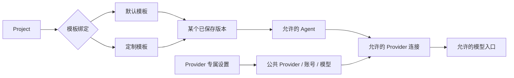

# Mixed Agents 模板配置：存储与界面设计

状态：按 2026-10-12 用户修正后的设计提案。替代 agent-provider-model-design.md 的首屏信息架构；原提案中账号身份、额度池、Cache 隔离与事务约束仍保留。本次仅文档和交互预览，未修改生产 bridge。

## 行为与验收（先于界面）

1. 面板首页是配置模板编辑：模板 → Agent → Provider/账号 → 允许的模型；每层范围清楚，不要求用户手工枚举运行组合。
2. 一套可编辑默认模板；定制模板从已保存模板复制，是独立副本，无隐式继承链。默认模板无法删除；复制不复制凭据、额度或 Cache。
3. Project 可选「使用默认模板」或一个已保存的定制模板，显示实际解析到的模板与版本。改绑仅影响后续任务，活跃任务使用启动时快照。
4. Provider/账号和模型为公共资源，可在面板增改；模板按 Agent 维护 Provider/模型 allowlist。相同 Provider 可被多个 Agent、多个模板引用，不重复配置账号。
5. 保存模板为原子发布：草稿不影响 Project，显示未保存状态，切换模板/页面不丢草稿；Project 只能绑定已保存模板。复制取已保存版本，不悄悄复制未保存草稿。保存时显示受影响 Project 数；已绑定 Project 后续任务使用最新保存版本。
6. 移除模板里的 Provider/模型引用只撤销使用权限，不删除公共资源。停用公共资源会使相关配置不可调用，并显示依赖；不能自动替换为未授权候选。
7. Limit 分两层：账号/Provider/共享 bridge 的全局硬限制，与模板调度限制。模板可以收紧，不能放宽硬限制。多个 Project 共用同账号额度和并发池；每个 Project 的模板并发只限制其自身任务，不能新增全局容量。
8. Provider 通用字段为名称、endpoint/协议、凭据引用、模型入口；特殊策略由该 Provider 的模块实现表单、验证、用量读取和选择解释。Z.ai 的闲时规则只在其专属模块中展示，不给其他 Provider 生成同样选项。
9. Agent 协议兼容性与 Provider 商业权益分别验证。原型中未来 Agent 可配置意图，但保持「尚未接入」；不因模板勾选就呈现可执行。
10. 原型可复制/编辑/保存模板、切换 Agent、按 Agent 授权模型、切换 Provider 专属表单、增加 Provider 连接和模型入口、保存公共资源、改绑 Project、观察未保存草稿与资源共享。全为演示状态，无真实凭据、配置写入或模型请求。支持键盘与 320–1024px 布局。

## 领域模型

Mixed Agents 消费「Project 解析后的模板」。模板给它一个受限的候选集合和策略，它再通过 Agent adapter 执行。运行组合是内部由引用关系解析出的调用入口，不是用户管理的主对象。



模板复制使用完整配置，后续修改互不传播。Project 的「使用默认」是动态指向当前默认模板；显式绑定某个定制模板不会因默认模板变化而变化。不加入 Project 局部字段覆盖，用户要差异配置就复制模板。

模板 Agent 启用状态、模型允许状态属于权限配置；Agent 安装、认证、真实额度、Provider 支持性属于资源状态。不能把启用等同于可执行。

## 存储：公共资源与配置版本分开

继续使用 SQLite；避免再建一套配置主写源。

| 实体 | 最小字段与约束 |
| --- | --- |
| `agent_runtimes` | 已发现/托管 Agent 实例、adapter、版本、支持性；保留前版设计 |
| `provider_connections` | id, provider_type, account_id, label, endpoint_ref, protocol, credential_ref, settings_schema_version, settings_json, revision, enabled；凭据只引用现有来源 |
| `provider_models` | id, connection_id, upstream_model_id, canonical_model_id?, display_name, capability_snapshot, revision, enabled；unique(connection_id, upstream_model_id)，Provider 同名模型不合并 |
| `templates` | id, name, current_revision, archived；默认模板 id 存 singleton `app_settings.default_template_id`，不能指向归档模板 |
| `template_versions` | template_id, revision, schema_version, payload_json, created_at；复合主键，版本不可变，保存时事务插入并更新 current_revision |
| `projects` | id, stable_project_ref, host_id, canonical_root?, name；优先使用宿主稳定 Project id，不按名称识别；fallback 的 host+规范路径唯一 |
| `project_template_bindings` | project_id 主键，template_id?；NULL=跟随默认，非空=显式定制模板，不保存展开副本 |
| `run_config_snapshots` | run_id/turn, project_id, template_id, template_revision, resource_revisions, resolved_config_json；启动时解析一次，不保存凭据 |

保留公共 `provider_accounts`、`quota_pools`、并发 claims、alias/probe 身份映射、额度观测。Provider connection 是可复用配置入口；同账号的多连接仍引用同一个 account/pool，不能凭 endpoint 或 API key 数量认为额度独立。

模板 payload 使用固定、带 schema_version 的结构，无通用规则脚本：

```json
{
  "agent_configs": [
    {
      "agent_runtime_id": "kimi-local",
      "enabled": true,
      "bindings": [
        {"provider_connection_id": "kimi-main", "allowed_model_ids": ["k3-256k"]},
        {"provider_connection_id": "zai-main", "allowed_model_ids": ["glm-53", "glm-53-flash"]}
      ]
    }
  ],
  "limits": {"max_parallel_per_project": 3},
  "selection": {"prefer_provider_discount_on_equal_fit": true}
}
```

V1 用版本化 JSON 保存模板内的少量层级配置；公共资源、Project 绑定、池与运行记录用关系表。不要同时再建立可独立修改的 template-agent/model 子表，形成双主写。若以后需要频繁查询模板引用，派生只读索引即可。

保存校验：引用存在；模型属于指定连接；每个启用 Agent 至少有一项有效绑定；allowlist 无重复；不支持的组合保留配置意图但标不可执行，未知不能当已验证；默认模板存在；并发为正整数。发布 uses compare-and-swap current_revision，避免两面板覆盖。模板内引用稳定资源 ID；Provider 入口改 upstream 标识视为新增入口，显示名改动可原位更新。

## Limit 的层级与生效方式

面板模板区编辑 `max_parallel_per_project` 和选择偏好。公共资源区编辑共享 bridge、Provider/账号并发、额度保护线与探测冷却。准入同时检查所有范围，模板上限不能替代共享 cap；模板不携带各自独立的用量计数。

例如两个 Project 都使用「并发 3」模板，而公共 Z.ai 账号最多 3：两个 Project 合计最多 3 个该账号调用。模板切换或复制也不能绕过 Kimi 同账号探测冷却、保护线或实现/测试模型系列独立性。

全局 Provider guard 开启时模板不能关闭它。选择偏好可以在模板关闭，Provider 事实和硬限制依旧生效。执行时解析模板版本与公共资源版本共同生成快照；更改 Provider 设置影响所有引用模板的后续任务，保存前显示影响范围，活跃 turn 保留原配置。

## Provider 按类型开发

模块是显式的 `provider_type -> handler` 注册，不依赖模型系列或字符串猜测。每个模块负责：

- 配置 schema、专属字段和局部表单；有 common connection 表单，也有 Provider 专属区。
- 读取/验证已有授权来源、发现模型、读取真实用量与 reset；纯读取默认不推理。
- 解释账号/额度共享关系、限额与准入；不足或未知提供结构化原因。
- 将专属优惠设置解析成选择偏好，给出适用模型/套餐、时区、观察证据与原因。
- schema 版本迁移与脱敏输出；未知 settings 字段拒绝保存，不能偷偷丢弃。

### 先做的模块

**Kimi Code**：账号身份、五小时保护、受限探测与冷却、账号顺序与并发；自家 Agent 权益按实际套餐证据解析。未知额度探测单独操作，加载配置不探测。

**Z.ai Coding Plan**：账号并发与真实额度保护；专属闲时偏好，包括启用、时区、工作日和高价窗口及适用模型。设置是否存在与模板是否采用优惠偏好分开。沿用现有 exact-alias/off-peak selector 语义，适合度相同时偏好，不等于自动排队或保证计费价格。

**通用 API**：endpoint/协议、凭据来源、手动模型列表与显式并发；无虚构套餐剩余或闲时政策。新 Provider 有专属行为时增加模块，不能靠万能优惠表单假装支持。

未来 Zcode/Claude Code 是 Agent adapter；若出现队列权益，队列提交/取消/恢复由具体 Agent 与 Provider 能力契约一起实现，模板只允许使用已有能力。未来功能不提前引入本地调度队列。

## 信息架构与流程

导航仅三项：**配置模板 / Provider 与模型 / Project 绑定**。

### 配置模板（首屏）

顶部选择模板、版本和保存状态，可从已保存模板复制定制模板；显示关联 Project 数与默认身份。左边是模板的 Agent 清单、是否启用和接入状态，右边编辑所选 Agent 的 Provider/账号与模型权限。每个 Provider 一个分组，模型用普通 checkbox；打开 Provider 设置跳到公共资源详情。Agent 无绑定时显示配置提示，不能伪装成功。

模板级 limit 在模型权限下，明确标「单 Project 并发」；公共账号限制只读提示/链接。保存按钮用于发布草稿，显示未保存的模板名称和改动影响；切换模板保留各自草稿。Project 绑定使用已保存版本。资源管理页新增模型后默认不加入任何模板的 allowlist，回模板显式勾选。

### Provider 与模型

左列表是可复用 Provider 连接（供应商/账号名）；右边是连接通用字段、授权来源状态、模型入口增改与专属策略。点击新增 Provider 先选类型，显示对应表单；新增模型必须有入口 id，可改显示名/能力配置，不能只靠人类名称识别。

保存公共设置前显示引用模板数和 Project 数。不在每个 Agent 内重复录入授权。权限表里停用模型只影响当前模板；公共页停用入口影响所有引用，必须显示依赖。

### Project 绑定

每行 Project、跟随默认/定制模板选择、当前生效版本与草稿状态。绑定的保存与模板发布分开。切换模板前可查看 Agent/Provider/model 范围摘要，不展开每次运行的组合。默认模板更新影响跟随默认的 Project；定制模板更新影响显式引用它的 Project。

## 实施顺序

1. 公共资源只读 projection + 模板/版本/Project 绑定 spec；保留现有 exact alias 与资源保护。
2. 先做模板 CRUD、保存校验、配置解析与 Project 绑定，不接新 Agent。
3. 面板可管理公共 Provider/模型；Kimi、Z.ai 分别复用/扩展现有模块，明确专属 schema 和影响范围。
4. 增加 Agent adapter 时只扩充 Agent 清单、兼容性和运行能力，模板结构保持稳定。

生产验收需跨家族实现/测试：默认与定制模板解析、草稿不发布、原子版本冲突、跨 Project 公共账号 cap、未授权候选拒绝、保护线不绕过、同 Provider 同账号入口池共享、两 Provider 同名模型隔离、资源停用影响、Provider schema 迁移与快照恢复。本轮原型测试不代表这些生产能力已实现。

## 本轮原型验收

GPT 编写原型；Kimi 家族独立编写 `template-qa.cjs`，9 项浏览器检查通过：三页导航、复制已保存模板、草稿与 Project 隔离及切换保留、Agent 权限独立、Provider 专属表单、新增连接/模型不自动授权、Project 改绑、320px 布局、无 fetch/XHR 请求。父作者另用浏览器人工操作确认模板发布到 v2、已绑定 Project 显示新版本、切回默认模板生效。

验收中修复了预览容器不允许原生 form 提交的问题，创建与保存按钮改为直接触发演示操作，保留输入校验。测试定位由 Kimi 作者更新并重跑。GLM-5.3-Flash 的首轮验收尝试超时且未产出测试文件；Kimi 首轮已产出脚本，但定位使用旧 submit 按钮，后由同家族维护完成。

未验证：真实配置写入、SQLite 迁移、跨进程容量、Project 宿主接入、实际 Provider 授权/计费和新 Agent adapter。预览仅保存本次演示状态，刷新后恢复示例数据；宿主仅记住界面所选页面/对象，不保存公共资源或模板草稿。
